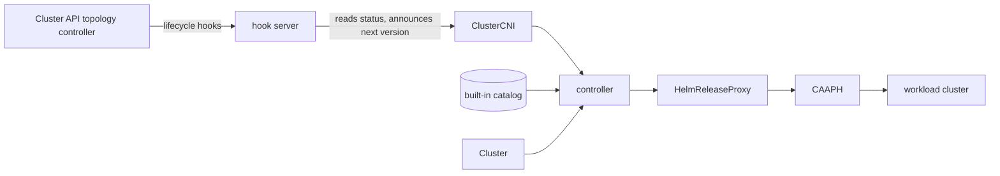

# cluster-api-addon-provider-cni

A [Cluster API](https://cluster-api.sigs.k8s.io) add-on provider that installs, upgrades and takes over the CNI of workload clusters. It works with any infrastructure, bootstrap and control plane provider, with or without ClusterClass.

You create one `ClusterCNI` per Cluster. The controller picks a CNI version that supports the cluster's Kubernetes version, installs it with the [Cluster API Add-on Provider for Helm](https://github.com/kubernetes-sigs/cluster-api-addon-provider-helm) (CAAPH), and upgrades it one supported step at a time. An optional set of Cluster API lifecycle hooks keeps the CNI in step with each control plane step of a Kubernetes upgrade, including chained upgrades across several minor versions.

Cilium and Calico are supported.

## How it works



- **The catalog** is compiled into the controller. For every CNI minor version it lists the latest patch, the Kubernetes versions upstream tests it against, and the versions it can be upgraded from. A daily workflow keeps the patches current.
- **The controller** reads the Cluster's Kubernetes version, resolves the target CNI version, and writes one `HelmReleaseProxy` per cluster for the next step on the way there. When CAAPH reports the release deployed, it takes the next step.
- **The hooks** (optional) hold each control plane step of a Kubernetes upgrade until the CNI supports the new version, and hold the workers while the CNI rolls out.

The controller only reads the core Cluster API contract (the Cluster, its control plane's `spec.version` and the `<cluster>-kubeconfig` Secret), so nothing in it is specific to a provider.

## Installing

The provider needs Cluster API v1.11 or later and CAAPH v0.6.2 or later. The lifecycle hooks need Cluster API v1.12 or later.

Add the provider to your `clusterctl.yaml`:

```yaml
providers:
  - name: cni
    type: AddonProvider
    url: https://github.com/vexxhost/cluster-api-addon-provider-cni/releases/latest/addon-components.yaml
```

Then install it together with CAAPH:

```sh
clusterctl init --addon helm --addon cni
```

To use the lifecycle hooks, enable the `RuntimeSDK` feature gate of Cluster API (`EXP_RUNTIME_SDK=true`) and register the hook server:

```sh
kubectl apply -f https://github.com/vexxhost/cluster-api-addon-provider-cni/releases/latest/download/extensionconfig.yaml
```

Upgrade the provider with `clusterctl upgrade apply --addon capi-cni-system/cni:vX.Y.Z`.

### Settings

| Variable | Default | Description |
|---|---|---|
| `CNI_LOG_LEVEL` | `2` | Log verbosity. |
| `CNI_CONCURRENCY` | `10` | ClusterCNIs reconciled in parallel. |
| `CNI_DIAGNOSTICS_ADDRESS` | `:8443` | Metrics and diagnostics address. |
| `CNI_INSECURE_DIAGNOSTICS` | `false` | Serve diagnostics over plain HTTP. |

## Using it

Create a `ClusterCNI` with the same name and namespace as the Cluster:

```yaml
apiVersion: cni.vexxhost.com/v1alpha1
kind: ClusterCNI
metadata:
  name: my-cluster
  namespace: default
spec:
  type: cilium
```

| Field | Description |
|---|---|
| `type` | `cilium` or `calico`. Immutable. |
| `version` | Empty follows the newest version that supports the cluster's Kubernetes version. `1.17` follows the latest patch of that minor. `1.17.5` pins that patch. Downgrades are refused. |
| `kubeProxyReplacement` | Makes the CNI replace kube-proxy (Cilium kube-proxy replacement, Calico eBPF dataplane), using the Cluster's control plane endpoint. |
| `podCIDRs` | Pod networks. Defaults to the Cluster's `spec.clusterNetwork.pods.cidrBlocks`. |
| `imageRepository` | A registry mirror for the CNI images, keeping the upstream image names. |
| `chartRepository` | A mirror of the Helm chart repository, such as an OCI registry. Immutable. |
| `providerConfig` | Helm values merged over the values the controller renders, for anything the fields above don't cover. A `null` removes a rendered value. |

The status reports the running and target versions and two conditions:

- `Ready` is true when the CNI runs its target version. Its reason says what the controller is doing: `Installing`, `Adopting`, `Upgrading`, or why it is stuck, such as `NoUpgradePath` or `DowngradeRejected`.
- `UpgradeCompatible` is true when the running CNI version supports the cluster's target Kubernetes version and any announced next version.

```console
$ kubectl get clustercnis
NAME         TYPE     VERSION   TARGET    READY   REASON     AGE
my-cluster   cilium   1.18.17   1.19.11   False   Upgrading  3d
```

### Upgrades

The controller upgrades the CNI along the catalog's upgrade path. Before leaving a minor version it moves to that minor's latest patch, then it moves one minor at a time (for both Cilium and Calico), waiting for each Helm release to finish rolling out.

During a Kubernetes upgrade, the CNI has to support the new version before the control plane moves:

- **With the lifecycle hooks**, Cluster API asks before each control plane step. The hook announces the step's version on the `ClusterCNI`, the controller moves the CNI to a version that supports both the current and the next Kubernetes version, and the hook lets the step proceed once it runs. Workers wait until the CNI rollout is done. If the catalog has no path for a step, `BeforeClusterUpgrade` refuses the upgrade with an explanation.
- **Without the hooks**, set the `cni.vexxhost.com/next-kubernetes-version` annotation on the `ClusterCNI` to the version you are about to upgrade to, wait for `UpgradeCompatible` to be true, then upgrade. The controller removes the annotation once the cluster runs that version.

Pinned versions are respected even when the catalog doesn't list the cluster's Kubernetes version for them; `UpgradeCompatible` turns false and the hooks refuse an upgrade the pinned version can't follow.

### Taking over an existing CNI

When a cluster already runs the CNI, for example installed by a ClusterResourceSet, the controller detects the running version from its image tag and first installs exactly that version with Helm's take-ownership option, so the takeover doesn't change the running pods as long as the values match. Use `providerConfig` to match settings that differ from the chart defaults. Then the normal upgrade path applies.

For Calico, the controller installs the tigera-operator, which migrates a manifest-based install from `kube-system` to `calico-system` by itself. The operator only migrates from the same Calico version, which the takeover step guarantees.

A ClusterResourceSet with the `Reconcile` strategy that keeps applying the CNI would fight the controller, so the controller stops with the `ConflictingClusterResourceSet` reason until that ClusterResourceSet uses `ApplyOnce` or no longer contains the CNI.

### Deleting

Deleting a `ClusterCNI` stops the controller from managing the CNI and leaves it running. The `HelmReleaseProxy` belongs to the Cluster and is removed with it.

## Supported versions

| CNI | Minor versions | Chart |
|---|---|---|
| Cilium | 1.15 to 1.20 | [cilium](https://helm.cilium.io) |
| Calico | 3.29 to 3.33 | [tigera-operator](https://docs.tigera.io/calico/charts) |

The Kubernetes versions of every minor are in [catalog/](catalog), each with a link to the upstream page they come from.

## Development

```sh
make test       # unit and envtest integration tests
make lint
make verify     # generated files are up to date
make test-e2e   # kind + CAPD end-to-end tests, needs Docker
```

`GINKGO_FOCUS` runs one e2e spec, for example `make test-e2e GINKGO_FOCUS='\[Adoption-Cilium\]'`. See [CONTRIBUTING.md](CONTRIBUTING.md) for changes to the catalog and [docs/proposal.md](docs/proposal.md) for the design.

## License

Apache License 2.0. See [LICENSE](LICENSE).
